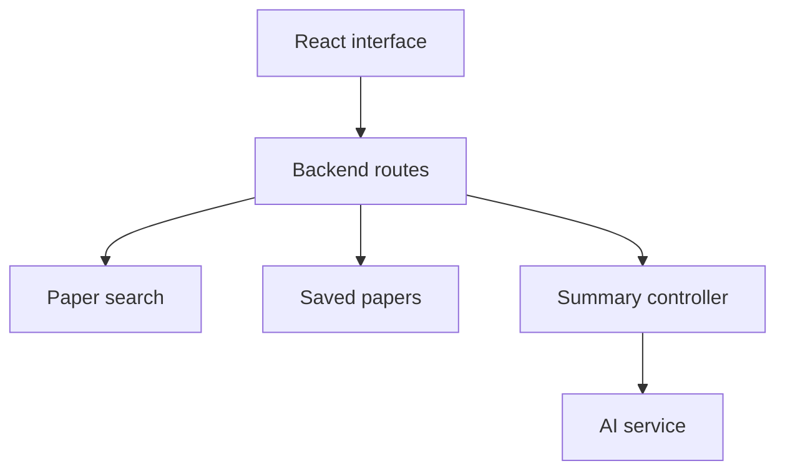

# AI Research Paper Hub

Search research papers, inspect paper details, and save papers for later reading. The application includes an OpenAlex import script and separate services for recommendations and AI-assisted summaries.

[Quick start](rpp_fixed/QUICKSTART.md) · [Application documentation](rpp_fixed/README.md) · [Project summary](rpp_fixed/PROJECT_SUMMARY.md)

## Architecture

## Explore the implementation

| Area | Source |
| --- | --- |
| Search, paper details and recommendations | [Frontend pages](rpp_fixed/frontend/src/pages) |
| HTTP endpoints | [Backend routes](rpp_fixed/backend/src/routes) |
| Paper ingestion | [OpenAlex import](rpp_fixed/backend/src/scripts/importOpenAlex.js) |
| Local services | [Compose configuration](rpp_fixed/docker-compose.yml) |

Start in the `rpp_fixed` directory when following the setup guide. The backend and frontend each include an example environment file. Keep credentials in local configuration.
